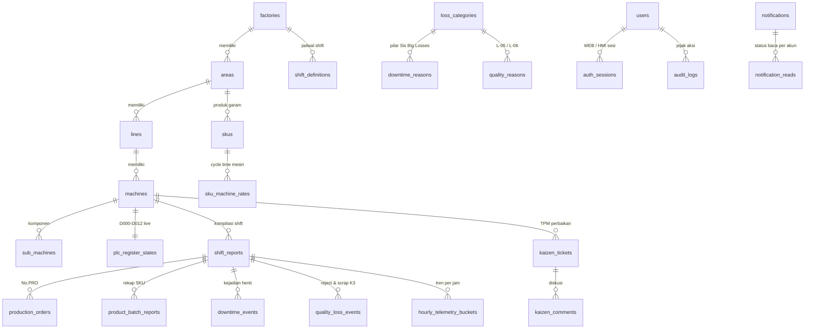

# Arsitektur Skema Database `ProductionCore OEE`

Dokumen ini mendefinisikan skema relasional [schema.sql](file:///home/npiping/Documents/Production/db/schema.sql) yang menaungi seluruh kebutuhan **Main Task 01 s.d. Main Task 17** untuk sistem pemantauan OEE, akuisisi Edge OT `PLC-ABC / GW-100`, konsol sentuh `Panel HMI-T7`, dan konsol manajemen Aplikasi Web.

## 1. Diagram Relasi Entitas Utama (ERD)

## 2. Pemetaan Tabel terhadap Main Tasks (`01 - 17`)

| Kelompok Modul | Tabel Database | Main Task Terkait | Penegakan Aturan Bisnis & Integritas di Tingkat DB |
| :--- | :--- | :--- | :--- |
| **Topologi Pabrik & PLC-ABC** | `factories`, `shift_definitions`, `areas`, `lines`, `machines`, `sub_machines` | Main Task 02 | Menyimpan IP `PLC-ABC`, port Modbus `502`, kode `GW-100`, `HMI-T7`, `BUZ-01`, ambang suhu `SEN-T01` (`155 - 185 C`), vibrasi `SEN-V01` (`4.5 / 7.1 mm/s`), dan batas *Small Stop* (`300 dtk`). |
| **Pengguna, RBAC, & Keamanan PIN/Sandi** | `users`, `auth_sessions`, `access_recovery_requests` | Main Task 01, 03, 07 | Memisahkan 5 peran (`OPERATOR`, `SHIFT_LEADER`, `SPV`, `ADMIN_MANAGER`, `SUPERADMIN`) dan 4 tipe personel, menyimpan *hash* `scrypt` sandi Web & PIN 6 digit HMI, penghitung gagal login (`5x -> kunci 5 menit`), dan tiket reset PIN/sandi (`15 menit`). |
| **Master SKU & Konversi Kemasan** | `skus`, `sku_machine_rates` | Main Task 04, 13, 16 | Menyimpan bobot bersih (`250g`, `500g`), konversi hierarki (`pcs -> inner -> karton`), `ideal_cycle_time_min` (`0.024 mnt/pcs` = `41.67 pcs/mnt`), serta kolom `unit_price_idr` *nullable* untuk mode dual-valuasi `Business Impact`. |
| **Master Six Big Losses & SOP Digital** | `loss_categories`, `downtime_reasons`, `quality_reasons`, `guidelines` | Main Task 05, 10, 14 | Memetakan kode `PLANNED` dan `L-01` s.d. `L-06`, pemetaan register `D001` ke alasan standar beserta rekomendasi *action tags*, alasan cacat/scrap K3, dan dokumen SOP digital. |
| **Akuisisi Edge OT & Buffer Sinkronisasi** | `plc_register_states`, `hourly_telemetry_buckets`, `edge_sync_queue` | Main Task 06, 12, 14 | Merepresentasikan blok 13 register `D000-D012` secara *live*, agregasi per jam untuk grafik garis `Performance Loss` & batang `Quality Loss`, serta antrean FIFO `GW-100` / `HMI-T7` saat offline. |
| **Order Produksi, Downtime, & Quality Loss** | `production_orders`, `downtime_events`, `quality_loss_events` | Main Task 08, 09, 12, 14 | Mendukung pencatatan tanpa order aktif (`production_order_id IS NULL` / *Without No. Production*), status `UNCLASSIFIED` vs `CLASSIFIED`, dan waktu redam buzzer `BUZ-01`. |
| **Kaizen TPM 2 Jalur & Diskusi** | `kaizen_tickets`, `kaizen_comments` | Main Task 11, 15 | Constraint `CHECK` tingkat tabel mencegah status ilegal seperti `OPEN + OK`; merekam faktor **Fishbone** (`MESIN`, `LINGKUNGAN`, `MANUSIA`, `METODE`, `MATERIAL`), bukti telemetri *before/after*, dan komentar ber-notifikasi. |
| **Laporan Shift & Batch Produk** | `shift_reports`, `product_batch_reports` | Main Task 13, 16 | Mendukung alur `NEEDS_APPROVAL -> APPROVED -> RELEASED`, granularitas `SHIFT`, `DAILY`, dan `MONTHLY`, komparasi fase `BASELINE_2022` vs `POST_TPM_2023`, serta kalkulasi aman `MTTR/MTBF` (`NULL` saat `0` breakdown). |
| **Audit Trail & Notifikasi Lintas Peran** | `audit_logs`, `notifications`, `notification_reads` | Main Task 10, 17 | Menyimpan *diff* `before_json -> after_json` dan memisahkan status baca notifikasi per akun (`notification_reads`) agar pembacaan oleh satu SPV tidak menghilangkan notifikasi penerima lain. |

## 3. Trigger Pengaman Integritas Data (SQLite Triggers)

1. **`trg_downtime_immutable_plc_times`**: Menolak (`RAISE(ABORT)`) setiap operasi `UPDATE` pada tabel `downtime_events` yang mencoba memanipulasi `start_time`, `machine_id`, `plc_trigger_register`, ataupun mengubah `end_time` dan `duration_minutes` yang telah distempel selesai oleh `PLC-ABC` (memenuhi URS `19.2.21` baris 3323-3324).
2. **`trg_downtime_lock_on_released_shift` & `trg_downtime_no_delete_on_released_shift`**: Menolak setiap pengeditan atau penghapusan baris `downtime_events` apabila `shift_reports` induknya sudah berstatus **`RELEASED`** (memenuhi Main Task 12 & Main Task 16).
3. **`trg_audit_logs_no_update` & `trg_audit_logs_no_delete`**: Mengunci tabel `audit_logs` agar bersifat *append-only* mutlak sehingga tidak ada akun (termasuk `SuperAdmin`) yang dapat mengubah atau menghapus jejak audit historis (memenuhi Main Task 17).

