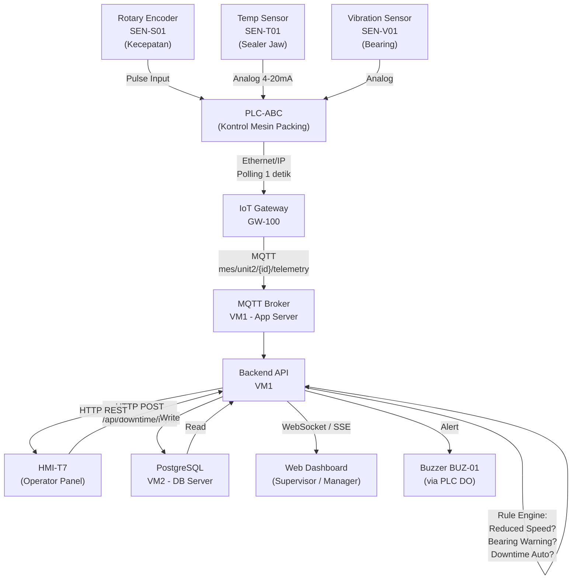

# Hardware-to-Software Integration Specification
## Sistem Digitalisasi OEE — Mesin Packing Unit 2
### Berbasis Studi Kasus: Jurnal Teknika Vol. 1 No. 1 (2023) — PT. XYZ
**Disusun oleh:** Nusantara MES Team  
**Tanggal:** 30 Oktober 2025 | **Versi:** 1.0

> [!NOTE]
> Semua nama hardware menggunakan **penamaan asumsi generik** (**PLC-ABC**, GW-100, SEN-S01, dll.). Dokumen ini dirancang modular sehingga spesifikasi integrasi dapat diterapkan pada controller industri standar tanpa keterikatan vendor tertentu. Mapping ke model aktual diatur terpisah.

---

## 1. Latar Belakang Teknis

Mesin packing di PT. XYZ beroperasi di **lingkungan korosif** (kandungan garam tinggi, kelembaban tinggi). Kondisi ini mengakibatkan:
- Bearing cepat aus → berkontribusi pada **Equipment Failure Loss (4.18%)**
- Sealer jaw terganggu korosi → berkontribusi pada **Reduced Speed Loss (16.47%)**
- Film feeding tidak lancar → **Idle & Minor Stoppage (9.35%)**

Infrastruktur IoT yang diusulkan harus **tahan kondisi ini** (IP54+ untuk perangkat lapangan) dan mampu mendeteksi ketiga kondisi tersebut secara otomatis sebelum losses terjadi.

---

## 2. Arsitektur Sistem (3 Layer)

```
┌────────────────────────────────────────────────────────────┐
│  LAYER 3 — APPLICATION LAYER                               │
│  Web Dashboard + HMI App                                   │
│  Server: App Server (VM1) + Database Server (VM2)          │
│  On-Premise di gedung produksi PT. XYZ                    │
└──────────────────────────┬─────────────────────────────────┘
                           │ HTTP REST / WebSocket
┌──────────────────────────▼─────────────────────────────────┐
│  LAYER 2 — EDGE / GATEWAY LAYER                            │
│  IoT Gateway GW-100 (1 unit per mesin packing)             │
│  Fungsi: agregasi sensor + PLC → transform → publish MQTT  │
└──────────────────────────┬─────────────────────────────────┘
                           │ MQTT over LAN (WiFi Industrial / Kabel)
┌──────────────────────────▼─────────────────────────────────┐
│  LAYER 1 — FIELD / DEVICE LAYER                            │
│  PLC-ABC (Kontrol utama mesin packing)                     │
│  SEN-S01 (Speed/RPM Encoder)                               │
│  SEN-T01 (Suhu Sealer Jaw)                                 │
│  SEN-V01 (Vibration Sensor Bearing)                        │
│  HMI-T7  (Panel Operator 7 inci)                           │
└────────────────────────────────────────────────────────────┘
```

---

## 3. Daftar Perangkat (Asumsi Generik)

### 3.1 Perangkat Field (Per Mesin Packing)

| Kode | Nama Generik | Tipe | Fungsi | Protokol |
|------|-------------|------|--------|----------|
| PLC-ABC | Programmable Logic Controller | PLC-ABC Series | Kontrol utama: hitung actual_count, deteksi downtime, baca input sensor | Ethernet/IP ke GW-100 |
| ENC-01 | Rotary Encoder | SEN-S01 | Ukur kecepatan aktual mesin (pcs/menit) — deteksi Reduced Speed | Pulse input ke PLC-ABC |
| TEMP-01 | Temperature Sensor Sealer Jaw | SEN-T01 | Monitor suhu sealer jaw (korosi di lingkungan garam mempercepat overheat) | Analog 4–20mA ke PLC-ABC |
| VIB-01 | Vibration Sensor Bearing | SEN-V01 | Deteksi awal aus bearing akibat korosi — Early warning Equipment Failure | Analog ke PLC-ABC |
| GW-01 | IoT Gateway | GW-100 | Baca register PLC-ABC, enrich data, publish MQTT | Ethernet, MQTT |
| HMI-01 | Operator Panel | HMI-T7 | Layar 7 inci touch screen, input produksi & downtime | Ethernet ke Switch Hub |
| SWH-01 | Industrial Switch Hub | SWH-8P | Penghubung HMI, GW-100, dan jaringan pabrik | Ethernet 100 Mbps |
| BUZ-01 | Buzzer / Alarm | BUZ-24V | Alarm suara saat downtime otomatis terdeteksi | Digital Output dari PLC-ABC |

### 3.2 Infrastruktur Server (On-Premise)

| Perangkat | IP (Asumsi) | Fungsi |
|-----------|------------|--------|
| App Server (VM1) | 192.168.10.10 | Web app + HMI backend + MQTT Broker |
| DB Server (VM2) | 192.168.10.11 | Database PostgreSQL |
| Admin PC | 192.168.10.20 | Akses web back office untuk Supervisor/Manager |

---

## 4. Topologi Jaringan

```
                    ┌──────────────────────┐
                    │     Server Room       │
                    │  VM1: 192.168.10.10   │
                    │  VM2: 192.168.10.11   │
                    └──────────┬───────────┘
                               │ LAN 192.168.10.x
              ┌────────────────┼─────────────────┐
              │                │                 │
   ┌──────────▼──────┐  ┌──────▼──────┐  ┌──────▼──────┐
   │ Mesin Packing 6 │  │ Mesin Pkng 5│  │ Admin PC    │
   │ (SWH-01)        │  │ (future)    │  │ .10.20      │
   └──┬──┬──┬────────┘  └─────────────┘  └─────────────┘
      │  │  │
   ┌──▼┐ ┌▼──┐ ┌▼─────────────────────────────────────┐
   │GW │ │HMI│ │       PLC-ABC                          │
   │-01│ │-01│ │  ┌────────┐ ┌────────┐ ┌────────────┐ │
   └───┘ └───┘ │  │ENC-01  │ │TEMP-01 │ │VIB-01      │ │
               │  │Speed   │ │Sealer  │ │Bearing     │ │
               │  │Encoder │ │Temp    │ │Vibration   │ │
               │  └────────┘ └────────┘ └────────────┘ │
               └──────────────────────────────────────┘
                                  │
                            ┌─────▼───┐
                            │ BUZ-01  │
                            │ Buzzer  │
                            └─────────┘
```

---

## 5. Alur Sinyal: Field → Gateway → Server

### 5.1 Sinyal Otomatis dari PLC + Sensor

```
SENSOR (ENC-01, TEMP-01, VIB-01)
    │
    │  Sinyal continuous ke PLC-ABC:
    │  - ENC-01 : pulse per detik → PLC hitung speed_ppm (pcs per menit)
    │  - TEMP-01 : analog 4–20mA → PLC konversi ke °C
    │  - VIB-01  : analog → PLC konversi ke mm/s (RMS vibration)
    │
    ▼
PLC-ABC (polling setiap 100ms)
    │
    │  Register yang di-maintain PLC:
    │  ┌───────────────┬─────────────────────────────────────────┐
    │  │ Register      │ Deskripsi                               │
    │  ├───────────────┼─────────────────────────────────────────┤
    │  │ D000          │ actual_count   — counter pcs sejak start │
    │  │ D002          │ speed_ppm      — kecepatan aktual pcs/min│
    │  │ D004          │ machine_status — 1=Run, 0=Stop           │
    │  │ D006          │ sealer_temp_c  — suhu sealer jaw (°C)    │
    │  │ D008          │ bearing_vib    — vibrasi bearing (mm/s)  │
    │  │ D010          │ downtime_flag  — 1=auto downtime aktif   │
    │  │ D012          │ downtime_type  — 0=none, 1=equip, 2=idle │
    │  └───────────────┴─────────────────────────────────────────┘
    │
    ▼ (baca via Ethernet/IP, polling 1 detik)
GW-100
    │  Transform & enrich:
    │  - Hitung delta_count = D000[t] - D000[t-1]
    │  - Hitung reduced_speed_flag jika speed_ppm < (ideal_speed × 0.80)
    │  - Tambahkan timestamp ISO 8601, machine_id, shift
    │
    ▼ (publish MQTT)
MQTT Broker (VM1) → Topic: mes/unit2/{machine_id}/telemetry
    │
    ▼
Backend API (VM1)
    │  Subscribe, parse, update state produksi di DB
    │  Trigger rule engine: reduced speed? equipment warning? downtime?
    │
    ▼
Database (VM2)
```

### 5.2 Input Manual dari Operator (HMI)

```
Operator melihat downtime terjadi
    │
    ▼
HMI-T7 menampilkan form:
    "Pilih kategori downtime:"
    ○ Equipment Failure (L-01)
    ○ Setup & Adjustment (L-02)
    ○ Idle & Minor Stoppage (L-03)
    ○ Material Shortage
    [Timer berjalan sejak mesin berhenti]
    │
    ▼ (HTTP POST ke VM1)
Backend API
    │  Simpan DowntimeEvent dengan:
    │  - category (L-01/L-02/L-03/material)
    │  - duration_min (dari PLC timestamp mesin berhenti)
    │  - operator_id + timestamp
    │  - source = 'Manual'
    │
    ▼
Database (VM2)
```

---

## 6. Mekanisme Deteksi Losses Otomatis

### 6.1 Deteksi Reduced Speed Loss (L-04) — Loss Terbesar 16.47%

Ini adalah loss yang paling kritis dan paling sulit dideteksi secara manual.

```
[Rule Engine di Backend — dijalankan setiap 30 detik]

IF speed_ppm < (ideal_speed_ppm × 0.80)
   AND machine_status = Running
   AND delta_count > 0  ← mesin masih jalan tapi lambat
THEN
   - Set reduced_speed_flag = TRUE
   - Catat SpeedLog dengan actual_speed, ideal_speed, gap
   - Kirim notifikasi ke dashboard: badge KUNING "Reduced Speed Detected"
   - Kirim alert ke HMI: tampilkan banner "Speed di bawah standar!"
   - Jika kondisi ini berlangsung > 15 menit → eskalasi ke alert SPV (MERAH)
```

**Kontribusi ke kalkulasi Performance Loss (L-04):**
```
Reduced Speed Loss Time = Operation Time − (Ideal CT × Total Produksi)
                        = Σ durasi semua event speed_ppm < threshold
```

### 6.2 Deteksi Equipment Failure (L-01) — Early Warning via Sensor

```
[Rule Engine — dijalankan setiap 60 detik]

RULE 1 — Bearing Warning:
  IF bearing_vib > 4.5 mm/s  ← threshold pre-failure (asumsi)
  THEN
    - Kirim notifikasi ke Maintenance: "Bearing vibration tinggi — cek pelumasan"
    - Catat EarlyWarning log

RULE 2 — Sealer Jaw Overheat:
  IF sealer_temp_c > 185°C  ← suhu kritis sealer jaw garam
  THEN
    - Set buzzer = ON
    - Kirim alert CRITICAL ke dashboard: "Temperature Sealer Jaw Melebihi Batas"
    - Trigger downtime record otomatis jika mesin berhenti dalam 5 menit berikutnya

RULE 3 — Auto Downtime (No Count):
  IF delta_count = 0 selama 5 menit berturut-turut
     AND machine_status = Running   ← PLC bilang running tapi tidak ada output
  THEN
    - Set downtime_flag = TRUE
    - Nyalakan BUZ-01
    - Kirim notifikasi HMI: "Mesin Berhenti — Input Alasan Downtime"
```

### 6.3 Deteksi Idle & Minor Stoppage (L-03)

```
[Rule Engine]

IF delta_count = 0 selama 30 DETIK tapi < 5 menit
   AND machine_status = Running
THEN
   - Catat sebagai MinorStoppage event dengan duration
   - Tidak memicu buzzer (untuk membedakan dengan downtime penuh)
   - Akumulasi di SpeedLog sebagai idle_time_min
```

---

## 7. Format Payload MQTT

### 7.1 Telemetri Reguler (dikirim setiap 1 detik)

```json
{
  "ts": "2023-05-26T08:15:30.000+07:00",
  "machine_id": "PKG-06-U2",
  "shift": 1,
  "actual_count": 12487,
  "delta_count": 1,
  "speed_ppm": 38.2,
  "ideal_speed_ppm": 41.67,
  "reduced_speed_flag": true,
  "machine_status": "running",
  "sealer_temp_c": 172.4,
  "bearing_vib_mms": 2.1,
  "downtime_flag": false,
  "source": "PLC-ABC"
}
```

### 7.2 Downtime Auto-Detected (dikirim saat downtime_flag berubah ke true)

```json
{
  "ts": "2023-05-26T09:32:00.000+07:00",
  "machine_id": "PKG-06-U2",
  "event_type": "DOWNTIME_START",
  "trigger": "NO_COUNT_5MIN",
  "last_speed_ppm": 0,
  "sealer_temp_c": 183.1,
  "bearing_vib_mms": 3.8,
  "buzzer_activated": true,
  "source": "PLC-AUTO"
}
```

### 7.3 Downtime Reason dari Operator (HTTP POST, bukan MQTT)

```json
{
  "ts": "2023-05-26T09:35:20.000+07:00",
  "machine_id": "PKG-06-U2",
  "event_type": "DOWNTIME_REASON",
  "loss_category": "L-01",
  "loss_name": "Equipment Failure",
  "sub_reason": "Spare Part Setting",
  "duration_actual_min": 76,
  "operator_id": "OPR-012",
  "source": "Manual-HMI"
}
```

---

## 8. Kalkulasi Six Big Losses di Backend

Backend menghitung Six Big Losses setiap akhir shift menggunakan data yang sudah terkumpul:

```
Loading Time  = Shift Duration − Planned Downtime (Rest Time + Briefing & Setup)
              = 1440 − (180 + 45) = 1215 menit  [contoh: 26/05/2023]

L-01 Equipment Failure   = Equipment Failure Time / Loading Time × 100%
                         = 76 / 1215 × 100% ≈ 6.25%

L-02 Setup & Adjustment  = (Briefing & Setup Time) / Loading Time × 100%
                         = 45 / 1215 × 100% ≈ 3.70%

L-03 Idle & Minor Stop   = Σ idle_time_events / Loading Time × 100%
                         = 230 / 1215 × 100% ≈ 18.93%

L-04 Reduced Speed       = (Operation Time − (Ideal CT × Total Prod)) / Loading Time × 100%
                         = (874 − (0.024 × 31468)) / 1215 × 100%
                         = (874 − 755.23) / 1215 × 100% ≈ 9.77%

L-05 Process Defect      = (Defect × Ideal CT) / Loading Time × 100%
                         = (398 × 0.024) / 1215 × 100% ≈ 0.79%

L-06 Scrap               = (Scrap × Ideal CT) / Loading Time × 100%
                         = (48 × 0.024) / 1215 × 100% ≈ 0.09%

─────────────────────────────────────────────────────────────────────
OEE Components:
  Availability = (Loading Time − Downtime_Unplanned) / Loading Time × 100%
               = (1215 − (76 + 35)) / 1215 × 100% = 90.86%

  Performance  = (Total Prod × Ideal CT) / Operation Time × 100%
               = (31468 × 0.024) / 874 × 100% = 86.41%

  Quality      = (Processed − Defect) / Processed × 100%
               = (31468 − 398) / 31468 × 100% = 98.74%

  OEE          = 90.86% × 86.41% × 98.74% = 77.52%  ✅ (sesuai jurnal)
```

> [!IMPORTANT]
> Nilai aktual dari contoh di atas diambil langsung dari Tabel 13 & 14 jurnal (data 26/05/2023). Backend harus menghasilkan angka yang identik sebagai validasi implementasi formula.

---

## 9. Data Flow Diagram



---

## 10. Skenario Offline & Failover

### Skenario A: HMI Tidak Bisa Reach Server
1. HMI masuk **offline mode** — input tetap bisa diterima, disimpan local storage HMI
2. Badge "Offline — Data Queued" ditampilkan di HMI
3. Saat koneksi pulih, HMI sync queue ke backend (FIFO order, max 4 jam buffer)
4. Backend simpan dengan flag `sync_delayed = true` dan timestamp asli dari HMI

### Skenario B: GW-100 Kehilangan Koneksi ke Server
1. GW-100 buffer telemetri di local storage (kapasitas 24 jam data)
2. Saat koneksi pulih, GW-100 re-publish dari buffer (timestamp asli dipertahankan)
3. Backend menandai periode gap sebagai `data_gap_detected` — **berbeda** dari downtime

### Skenario C: Koneksi PLC ke GW Terputus
1. GW-100 mendeteksi tidak ada data dari PLC > 30 detik → publish event `TELEMETRY_GAP`
2. Backend mencatat gap sebagai `unknown_status` — tidak dihitung sebagai uptime atau downtime sampai data kembali
3. Notifikasi dikirim ke Maintenance: "Koneksi PLC-ABC terputus"

---

## 11. Checklist Kesiapan Hardware Sebelum Go-Live

| Item | Kondisi Siap | Verifikasi oleh |
|------|-------------|-----------------|
| PLC-ABC terpasang, bisa ping dari GW-100 | No packet loss pada ping test 100x | Hardware Engineer |
| ENC-01 (encoder) menghasilkan pulse yang akurat | Bandingkan speed_ppm dengan stopwatch manual selama 1 menit | Hardware Engineer |
| TEMP-01 membaca suhu sealer jaw sesuai referensi thermometer | Selisih < 2°C dari termometer referensi | Hardware Engineer |
| VIB-01 membaca vibrasi baseline mesin normal | Catat nilai baseline saat mesin berjalan normal → set threshold +50% | Hardware Engineer |
| GW-100 subscribe ke MQTT broker VM1 | Topic mes/unit2/# aktif, payload masuk di broker | Data Engineer |
| Register PLC D000–D012 bisa dibaca GW-100 | Nilai berubah saat mesin jalan/berhenti | Hardware Engineer |
| HMI-T7 bisa akses backend via HTTP | Login berhasil, form input muncul | QA |
| Buzzer BUZ-01 aktif saat downtime_flag=1 | Simulasi: stop mesin 5 menit → buzzer bunyi | Hardware Engineer |
| IP address semua perangkat tidak conflict | Ping test semua IP → tidak ada reply ganda | E&M IT |
| End-to-end test: mesin jalan 10 menit, cek dashboard | actual_count di dashboard = nilai counter PLC | QA |
| Validasi formula OEE: input data 26/05/2023 → OEE harus = 77.52% | Unit test backend dengan data jurnal sebagai fixture | Data Engineer |

---

*Dokumen ini mengacu pada: Jurnal TEKNIKA Vol. 1 No. 1 (2023) — "Analisis Pengukuran Efektifitas Mesin Packing di Unit 2 Menggunakan OEE dengan Pendekatan TPM" oleh Muhammad Kholis Al Farichi & Hery Murnawan.*
